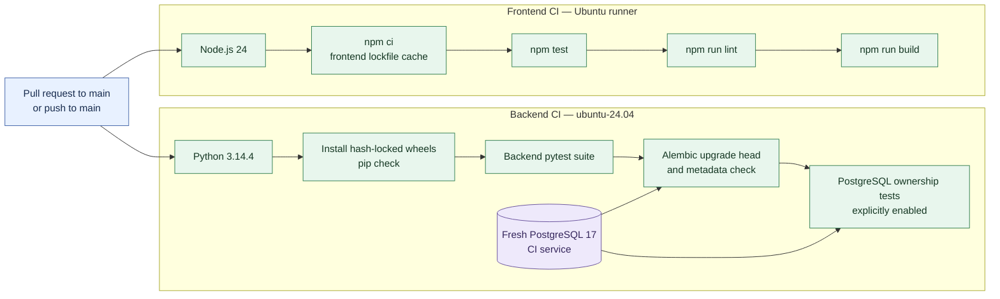

# CI Pipeline — implemented GitHub Actions

The [Backend CI](../../.github/workflows/backend-ci.yml) and
[Frontend CI](../../.github/workflows/frontend-ci.yml) workflows run on pull
requests targeting `main` and pushes to `main`. They validate source; they do
not deploy the application or publish release images.

Backend CI's `alembic upgrade head` targets its fresh CI database. The isolated
development stack instead requires a separately reviewed migration target and
operator approval. PostgreSQL ownership tests are explicitly enabled and run in
Backend CI. Playwright browser E2E tests do **not** run in GitHub Actions; neither
workflow contains a deployment or image-publishing stage.
