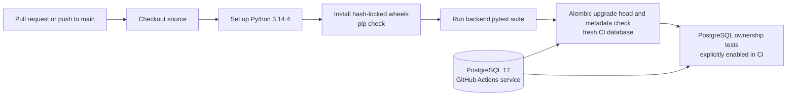

# CI pipeline — implemented GitHub Actions workflow

This diagram reflects [backend-ci.yml](../../.github/workflows/backend-ci.yml).
It is separate from the **unprovisioned** Compose stack.

The workflow has no Docker image build, registry push, or deployment stage.
The current workflow explicitly enables and runs the PostgreSQL ownership tests.
Its `alembic upgrade head` on the fresh CI database differs from the isolated
stack's separately reviewed migration target.
The separate receipt-bound PostgreSQL harness is not enabled by this workflow.
