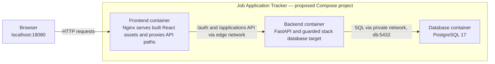

# Container view — proposed, unprovisioned stack

This C4-style container diagram shows logical application and data-store roles.
Here, each role maps to a proposed Docker container in `compose.stack.yaml`;
the C4 term "container" does not itself mean a Docker container. Vite builds
React assets into the frontend image; it is not a runtime server in this stack.

Only Nginx has a published host port. The browser's exact origin must match
`AUTH_ALLOWED_ORIGINS`; CSRF headers are required for protected mutations, not
every browser request. The backend requires separately approved migrations
before application requests; image startup does not run Alembic.
