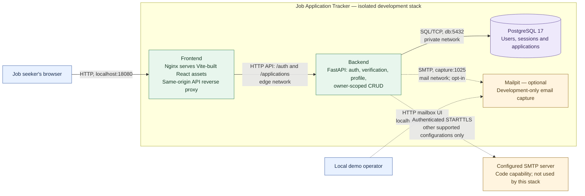

# C4 Container View — Job Application Tracker

These are logical C4 application containers and data stores, mapped to services
in `compose.stack.yaml`. A C4 container is not inherently a Docker container.
Vite builds React assets into the frontend image; Nginx serves them at runtime.
The [runbook](../container-stack.md) records one manual local run and shutdown;
this view makes no claim about current availability.

Only Nginx and the optional Mailpit UI publish loopback host ports. FastAPI
enforces session, trusted-origin, CSRF, and owner checks; CSRF applies to
protected mutations, not every browser request. Verification links are delivered
only when a sender is explicitly configured. Migration `0004` defines the
outbox table, but no outbox worker or production path uses it. Migrations require
separate approval and are not run at API startup.
