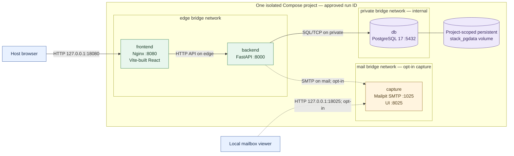

# Docker Deployment View — isolated local stack

This shows the resources defined by `compose.stack.yaml` for an approved
`jobtracker-stack-<run-id>` project. It is a local development deployment design,
not a public deployment or evidence of current availability. A
[recorded manual run](../container-stack.md) on 2026-10-29 was stopped afterward
with its database volume preserved; current runtime state has not been checked.

The backend also joins `private` and `mail`; the frontend joins only `edge`,
PostgreSQL joins only `private`, and Mailpit joins only `mail`. Only the frontend
and optional mailbox UI publish host ports, both on loopback. Mailpit uses
disposable tmpfs mail storage; PostgreSQL uses the project-scoped persistent
volume. The private network is `internal: true`; the mail network is not.

Compose waits for a healthy database before backend startup and a healthy
backend before frontend startup. Health checks do not apply migrations. The
capture service requires an explicit profile, reviewed image digest, and
development-only delivery setting; normal production SMTP is not part of this
stack. Project naming alone does not establish resource identity or safety.
Follow the runbook's separate preflight and approval gates.
