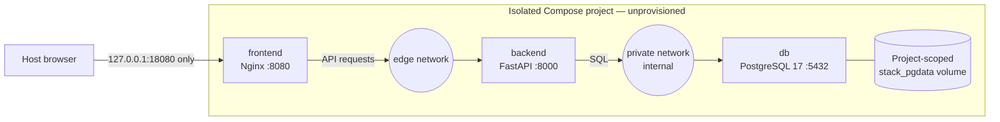

# Docker deployment — proposed, unprovisioned stack

The diagram shows intended resources in one new
`jobtracker-stack-<approved-run-id>` Compose project. It does **not** show a
running deployment or any protected original/demo resources.

PostgreSQL and FastAPI publish no host ports. The frontend joins only `edge`,
the database joins only `private`, and the backend joins both. Compose scopes
the volume and networks to the approved project name; naming alone does not
prove resource availability or Docker daemon identity. See the
[operator runbook](../container-stack.md) for separate preflight and approval
steps. Compose waits for a healthy database before starting the backend and a
healthy backend before starting the frontend; these checks do not apply
migrations. No Mailpit or real SMTP service is part of this proposal.
