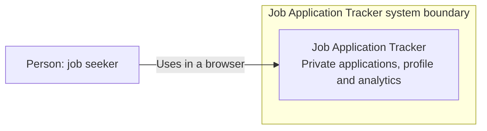

# C4 System Context — system and interactions

This C4-style System Context diagram shows the Job Application Tracker system,
its primary user, and their external browser interaction. It does not describe
the source code. The new container stack in `compose.stack.yaml` is **proposed
and unprovisioned**.

The application code supports account registration and email verification, but
the proposed stack sets `EMAIL_DELIVERY_MODE=none`. It has no operating email
provider or capture service. The transactional email outbox is disabled.
