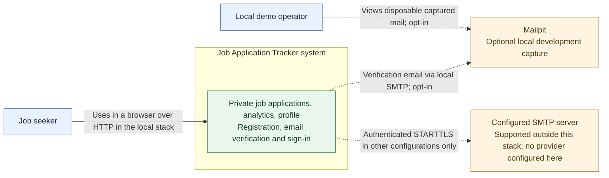

# C4 System Context — Job Application Tracker

This C4-style context view shows the system, its primary user, and external
interactions. It does not describe source files or a currently running service.
The [isolated stack runbook](../container-stack.md) records one manual local run
on 2026-10-29 followed by shutdown; current availability has not been checked.

The isolated Compose stack defaults to no email delivery. Its optional,
development-only Mailpit capture is shown in the container and deployment views;
it is not a production email provider. Normal SMTP is supported by application
code but forbidden in this stack mode. The transactional email outbox remains
disabled.
